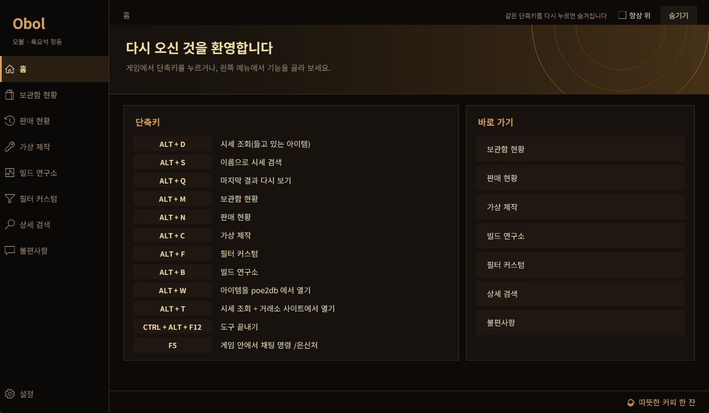
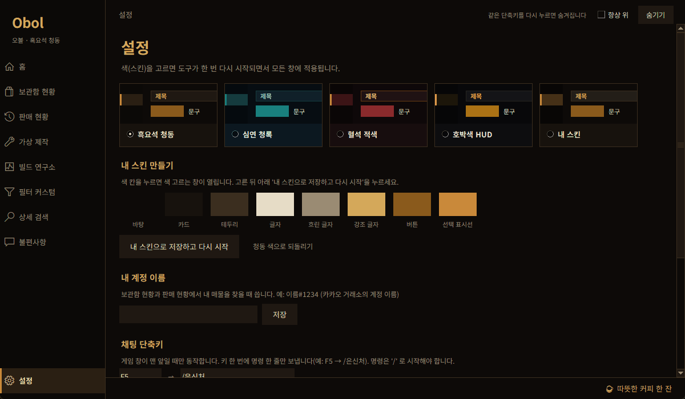

# Obol (오볼)

> **Korean (Kakao Games) server only.** Obol is a Korean-language price-check / stash / crafting helper for Path of Exile 2 on the Kakao Games (Korea) service. It does not support the global servers.

Path of Exile 2 (카카오게임즈) 한글 전용 **시세 · 보관함 · 제작 · 빌드 비교** 도구입니다.

## 다운로드

**https://paylupin84.github.io/obol** 에서 버튼 하나로 받을 수 있습니다. 설치는 필요 없습니다(파이썬도 필요 없음).

직접 받기: [Obol.exe](https://github.com/paylupin84/obol/releases/latest/download/Obol.exe) · [최신 버전 페이지](https://github.com/paylupin84/obol/releases/latest)

## 할 수 있는 것

| 단축키 | 기능 |
|---|---|
| `Alt+D` | **시세 조회** — 게임에서 아이템에 마우스를 올리고 누르면 옵션 수치 근처의 비슷한 매물 가격을 보여 줍니다. 줄에 마우스를 올리면 그 매물의 옵션이 보입니다. |
| `Alt+S` / `Alt+Q` | 이름으로 시세 검색 / 마지막 결과 다시 보기 |
| `Alt+T` | 시세 조회 + 같은 검색을 거래소 사이트에서 열기 |
| `Alt+W` | 마우스 밑 아이템을 poe2db 에서 열기 |
| `Alt+M` / `Alt+N` | **보관함 현황**(내 매물의 총 가치·변동) / **판매 현황** |
| `Alt+C` | **가상 제작** — 접두·접미 모드를 가중치대로 뽑는 시뮬레이터(투구·장비·반지·주얼 등). 만든 아이템과 비슷한 매물 시세도 봅니다. |
| `Alt+B` | **빌드 연구소** — 유명한 빌드(PoB 코드, pobb.in, poe.ninja 링크)를 가져와 내 빌드와 견주고, 옵션마다 '맞춘다 / 포기'를 고르고, 비슷한 매물 시세나 가상 제작으로 이어 갑니다. |
| `Alt+F` | **필터 커스텀** — 루트 필터에 강조·소리를 추가 |
| `F5` | 게임 안에서 채팅 명령 `/은신처` (설정에서 바꿀 수 있음, 게임 창이 맨 앞일 때만) |

그 밖에 스킨 4종 + 직접 만드는 스킨, 게임을 켜면 자동 실행(설정에서 끌 수 있음), 도구 안 **불편사항** 탭이 있습니다.

## 처음 켤 때 알아 둘 것

- 게임이 관리자 권한으로 실행되기 때문에 Obol 도 **관리자 권한 허용 창**이 뜹니다. '예' 를 눌러 주세요.
- 서명되지 않은 프로그램이라 윈도가 "알 수 없는 게시자" 경고를 보여 줄 수 있습니다. '추가 정보 → 실행' 으로 열 수 있습니다.
- 보관함·판매 현황을 쓰려면 **설정 탭에서 내 계정 이름**(예: `이름#1234`)을 한 번 입력하세요.
- 판매 기록 읽기는 이 PC의 크롬으로 내 계정에 로그인해서 **내 기록만** 읽습니다. 아이디·비밀번호는 저장하지 않습니다.
- 처음 켜면 윈도 시작 항목에 '게임 감시기'가 등록되어, POE2 를 켜면 Obol 이 자동으로 켜집니다. 설정 탭에서 끌 수 있습니다.
- 도구는 게임 화면을 읽거나 마우스를 조작하지 않고, 게임 메모리를 건드리지 않습니다. 단축키 `F5` 같은 채팅 명령은 **키 한 번에 명령 한 줄**만 보냅니다. 시세는 카카오 거래소 공개 검색과 poe.ninja 를 사용합니다.

## 불편사항 · 건의

도구 안의 **불편사항** 탭에서 보내 주세요(신규 업데이트 요청 / 작동의 문제 / 설명의 부재 / 기타). 모아서 2주마다 가능한 것부터 고칩니다. 계정 이름 같은 개인 정보는 보내지 않으며, 적지 마세요.

## 후원

도구 오른쪽 아래의 **☕ 따뜻한 커피 한 잔**을 누르면 카카오페이 QR 이 열립니다. 후원은 자유이고, 모든 기능은 그대로 무료입니다.

## 출처와 면책

- Obol 은 비공식 팬 도구이며 Grinding Gear Games, 카카오게임즈와 관계가 없습니다.
- 제작 시뮬레이터의 접두·접미 데이터: [poe2db.tw](https://poe2db.tw) (CC BY-NC-SA 3.0)
- 화폐 시세: [poe.ninja](https://poe.ninja)
